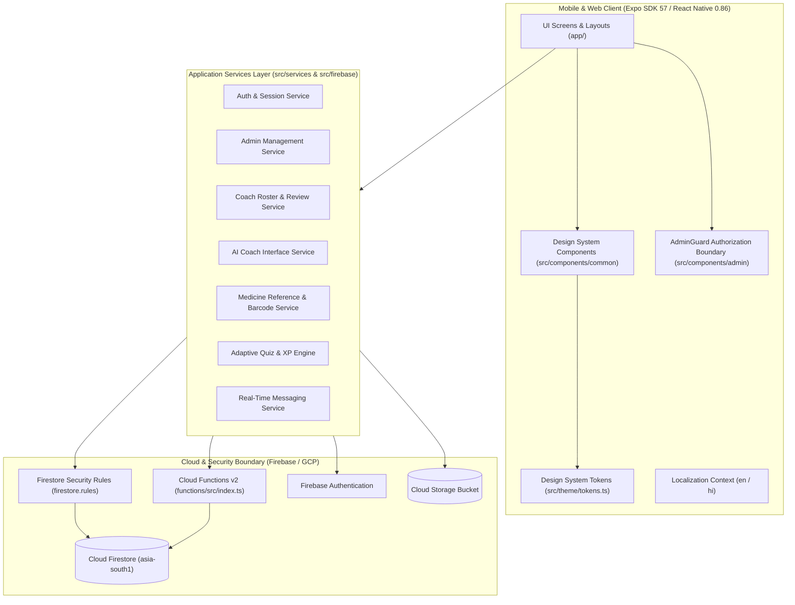

# AntiDopX 2.0 — Current Architecture Specification

**Document Version:** 2.0.0  
**Status:** Baseline Audited  
**Date:** 2026-11-22  

---

## 1. High-Level Architectural Diagram

---

## 2. Layer-by-Layer Decomposition

### 2.1 Presentation & Routing Layer (`app/`)
- **Technology:** Expo Router 57 (file-based routing on top of `@react-navigation/native` v7).
- **Navigation Topology:**
  - `app/_layout.tsx`: Root stack navigator wrapped with `LocalizationProvider`, `ThemeProvider`, and global `StatusBar`.
  - `app/(tabs)/_layout.tsx`: 4-tab bottom navigation (`dashboard.tsx`, `learning-journey.tsx`, `leaderboard.tsx`, `profile.tsx`).
  - `app/admin/`: Protected admin panel with sub-routes (`dashboard.tsx`, `users.tsx`, `modules.tsx`, `medicines.tsx`, `audit.tsx`, `settings.tsx`).
  - `app/coach/`: Coach portal (`dashboard.tsx`, `athletes.tsx`, `athlete-detail.tsx`).
  - `app/chat/[conversationId].tsx`: Direct 1-on-1 athlete-coach real-time messaging.
  - `app/medicinescanner.tsx`: Barcode reader and OCR camera viewfinder.
  - `app/ai-coach.tsx`: Conversational AI tutor interface.

### 2.2 Reusable Component & Design System (`src/components/`, `src/theme/`)
- **Tokens (`src/theme/tokens.ts`):** Central source of truth for:
  - Colors: Deep navy background (`#0B132B`), slate surfaces (`#1E293B`), cyan accent (`#06B6D4`), semantic status colors.
  - Spacing scale: `xs: 4`, `sm: 8`, `md: 12`, `lg: 16`, `xl: 20`, `xxl: 24`, `hero: 32`.
  - Radii & Shadows: Standardized curvature and multi-elevation cards.
- **Core UI Primitives:** `AppButton`, `AppCard`, `AppBadge`, `ProgressBar`, `HeaderBar`, `FeedbackCard`.
- **Zero Decorative Emojis:** 100% vector iconography using `@expo/vector-icons` (`Ionicons`, `MaterialIcons`, `Feather`).

### 2.3 Application Services Layer (`src/services/`, `src/firebase/`)
- **`adminAuthService.ts`:** Server-backed multi-tier admin verification.
- **`adminService.ts`:** Firestore real-time listener queries for users, stats, modules, audit logs.
- **`coachService.ts`:** Assigned athlete aggregation, metrics calculation, and performance tracking.
- **`aiCoachService.ts`:** Grounded knowledge-base retrieval engine with English & Hindi support.
- **`medicineReferenceService.ts`:** WADA 2026 active ingredient safety categorization.
- **`chatService.ts`:** Firestore subcollection message streaming with delivery timestamps.
- **`xpUtils.ts`:** Pure functional leveling mathematics and gamification thresholding.

### 2.4 Cloud Backend & Security Rules (`functions/`, `firestore.rules`)
- **Cloud Functions (`functions/src/index.ts`):** Node 20 runtime deployed to region `asia-south1`.
  - `submitQuizArena`: Server-side scoring, atomic transaction for XP and achievements, immutable audit log.
  - `lookupMedicine`: Server-side normalized ingredient query against verified database.
  - `setUserRole`: Admin-only callable for role promotion / demotion.
  - `askAICoach`: Grounded anti-doping advisory callable with regulatory citations.
- **Firestore Security Rules (`firestore.rules`):**
  - Granular RBAC (`ATHLETE`, `COACH`, `ADMIN`).
  - Privilege escalation prevention (`notEscalatingToAdmin()`).
  - Conversation privacy: restricted strictly to participating UIDs or verified Admin.
  - Immutable audit logs (`allow create: if signedIn(); allow update, delete: if false;`).

---

## 3. Data Schema & Collection Map

| Collection | Document Key | Schema Attributes | Access Constraints |
| :--- | :--- | :--- | :--- |
| `users` | `uid` | `name`, `email`, `role`, `sport`, `xp`, `level`, `streak`, `achievements`, `progress`, `quizScores`, `dailyMission` | Owner update, Coach read assigned, Admin full |
| `adminConfig` | `authorization` | `adminUids: string[]`, `updatedAt` | Read by signed-in, Write by Admin only |
| `coachAssignments` | `{coachUid}_{athleteUid}` | `coachId`, `athleteId`, `coachName`, `athleteName`, `status` (`ACTIVE`/`INACTIVE`), `assignedAt` | Coach & Athlete read, Admin full |
| `conversations` | `{athleteUid}_{coachUid}` | `participants: string[]`, `lastMessageText`, `lastMessageTime`, `lastSenderId`, `updatedAt` | Participants only |
| `conversations/{id}/messages` | `auto-id` | `senderId`, `senderName`, `senderRole`, `recipientId`, `text`, `createdAt`, `read` | Participants only |
| `medicineEntries` | `auto-id` | `medicineName`, `normalizedAliases: string[]`, `referenceStatus`, `activeIngredients`, `notes`, `source`, `lastVerified` | Read by all, Write by Admin |
| `curriculumModules` | `moduleId` | `title`, `shortTitle`, `category`, `durationMinutes`, `lessons`, `quiz` | Read by all, Write by Admin |
| `quizQuestions` | `questionId` | `question`, `options: string[]`, `correctOptionIndex`, `explanation`, `category` | Read by all, Write by Admin |
| `auditLogs` | `auto-id` | `userId`, `action`, `timestamp`, `metadata` | Read by Admin, Append-only |
| `systemSettings` | `settingId` | `maintenanceMode`, `aiEnabled`, `allowedRegistrations`, `minAppVersion` | Read by all, Write by Admin |

---

## 4. Current Architectural Vulnerabilities

1. **Client-Side Service Fallback Divergence:** When Cloud Functions fail or are not yet deployed, client fallbacks use different data contracts and non-transactional writes.
2. **Sequential Query Latency (N+1):** Coach dashboard queries loop sequentially across athlete documents.
3. **Missing Index Definitions:** Composite queries are not declared in a deployable index file (`firestore.indexes.json`).
4. **Offline Cache Divergence:** Local profile storage (`userService.ts`) can drift out of sync with Firestore if writes fail midway.
