# AntiDopX 2.0 — Phased Implementation Roadmap

**Document Version:** 2.0.0  
**Audit Date:** 2026-11-22  
**Target Architecture:** AntiDopX 2.0 Production-Ready Sports-Tech Platform  
**Workflow Engine:** GSD Spec-Driven Context Engineering

---

## Roadmap Overview & Dependency Graph

```mermaid
flowchart TD
    P0["Phase 0: Repository Audit (COMPLETE)"] --> P1["Phase 1: Architecture & Technical Specs"]
    P1 --> P2["Phase 2: Security & Environment Review"]
    P2 --> P3["Phase 3: Data Integrity & Race-Condition Prevention"]
    P3 --> P4["Phase 4: Query Optimization & Indexing"]
    P4 --> P5["Phase 5: Observability & Error Monitoring"]
    P5 --> P6["Phase 6: API Rate Limiting & Abuse Prevention"]
    P6 --> P7["Phase 7: AI Usage & Cost Monitoring"]
    P7 --> P8["Phase 8: Background Jobs & Cron Automation"]
    P8 --> P9["Phase 9: Staging & Production Separation"]
    P9 --> P10["Phase 10: Deployment Rollback Procedures"]
    P10 --> P11["Phase 11: Backup & Disaster Recovery Verification"]
    P11 --> P12["Phase 12: AI Coach Grounding & Contract Alignment"]
    P12 --> P13["Phase 13: Personalized Adaptive Learning"]
    P13 --> P14["Phase 14: Medicine Scanner & Verification Reliability"]
    P14 --> P15["Phase 15: Coach Portal & Messaging Hardening"]
    P15 --> P16["Phase 16: Admin Panel & Real Data Enforcement"]
    P16 --> P17["Phase 17: Multilingual Coverage (EN/HI)"]
    P17 --> P18["Phase 18: UI/UX Token Polish & Accessibility"]
    P18 --> P19["Phase 19: Automated Testing & CI Harness"]
    P19 --> P20["Phase 20: Final Documentation & Release Verification"]
```

---

## Phased Execution Plan

### Phase 0: Repository & Dependency Audit (COMPLETED)
- **Objective:** Establish baseline versions, catalog features, identify defects, evaluate security and performance.
- **Deliverables:** `PROJECT_AUDIT.md`, `CURRENT_ARCHITECTURE.md`, `FEATURE_STATUS.md`, `SECURITY_AUDIT.md`, `PERFORMANCE_AUDIT.md`, `IMPLEMENTATION_ROADMAP.md`.
- **Status:** **VERIFIED COMPLETE**.

---

### Phase 1: Technical Specification & Interface Contracts
- **Objectives:** Align Cloud Function and Client Service contracts (`.answer` vs `.reply`), standardize `ServiceResponse<T>`, define unified error structures.
- **Dependencies:** Phase 0.
- **Files Affected:** `src/types/ai.ts`, `src/types/serviceResponse.ts`, `functions/src/index.ts`, `src/services/aiCoachService.ts`.
- **Implementation Tasks:**
  1. Synchronize `AICoachResponse` in `src/types/ai.ts` with `functions/src/index.ts`.
  2. Define idempotency key types for quiz submissions and transactions.
- **Acceptance Criteria:** Zero type mismatches across client-server interface contracts.

---

### Phase 2: Security & Environment Review
- **Objectives:** Harden Firestore rules, eliminate all possibility of client-side role elevation, review `.env` variable configuration.
- **Dependencies:** Phase 1.
- **Files Affected:** `firestore.rules`, `src/firebase/config.ts`, `src/services/adminAuthService.ts`.
- **Implementation Tasks:**
  1. Audit `firestore.rules` for every subcollection (`messages`, `auditLogs`, `adminConfig`).
  2. Verify environment variable fallback hierarchy.
- **Acceptance Criteria:** `firestore.rules` rejects non-admin attempts to modify `/adminConfig` or assign `role: 'ADMIN'`.

---

### Phase 3: Data Integrity & Race-Condition Prevention (Requirement 7.1)
- **Objectives:** Prevent duplicate XP awards, double-submissions, and race conditions during simultaneous quiz completions or streak updates.
- **Dependencies:** Phase 2.
- **Files Affected:** `functions/src/index.ts`, `src/firebase/quizService.ts`, `src/firebase/streakService.ts`.
- **Implementation Tasks:**
  1. Require unique `submissionId` in `submitQuizArena` Cloud Function.
  2. Implement idempotency check inside Firestore transaction: check if `submissionId` exists in `auditLogs` or user attempt history before awarding XP.
  3. Remove client-side fallback write to `userRef.xp` that bypasses server verification.
- **Acceptance Criteria:** Submitting the identical quiz answers twice yields zero additional XP on the second invocation.

---

### Phase 4: Firestore Query Optimization & Indexing (Requirement 7.2 & 7.8)
- **Objectives:** Eliminate N+1 queries in coach dashboard, introduce `firestore.indexes.json`, implement aggregation count queries.
- **Dependencies:** Phase 3.
- **Files Affected:** `src/services/coachService.ts`, `src/services/adminService.ts`, `firebase.json`, `firestore.indexes.json`.
- **Implementation Tasks:**
  1. Refactor `getCoachDashboardMetrics` to fetch athletes in chunks of 30 via `where(documentId(), 'in', batch)`.
  2. Create `firestore.indexes.json` with composite indexes for `coachAssignments` (`coachId` + `status`), `conversations` (`participants` + `updatedAt`), and `auditLogs`.
  3. Implement `getCountFromServer` for admin total user counting.
- **Acceptance Criteria:** Loading coach dashboard for 50 athletes consumes at most 3 Firestore reads instead of 51.

---

### Phase 5: Error Monitoring & Observability (Requirement 7.3)
- **Objectives:** Implement structured diagnostic error telemetry for mobile crashes, Cloud Function failures, and network timeouts.
- **Dependencies:** Phase 4.
- **Files Affected:** `src/services/errorMonitoringService.ts`, `app/_layout.tsx`, `functions/src/index.ts`.
- **Implementation Tasks:**
  1. Build centralized error reporter capturing timestamps, device OS, app version, and sanitized error messages.
  2. Add React Error Boundary wrapping the root navigation tree.
- **Acceptance Criteria:** Uncaught UI exceptions display a graceful error fallback card without crashing the process.

---

### Phase 6: API Rate Limiting & Abuse Prevention (Requirement 7.4)
- **Objectives:** Protect Cloud Functions (`askAICoach`, `lookupMedicine`, `submitQuizArena`) against denial-of-service and high-frequency invocation.
- **Dependencies:** Phase 5.
- **Files Affected:** `functions/src/index.ts`, `functions/src/rateLimiter.ts`.
- **Implementation Tasks:**
  1. Implement sliding-window rate limiter in Cloud Functions using Firestore cache timestamps:
     - `askAICoach`: 10 req/min.
     - `lookupMedicine`: 20 req/min.
     - `submitQuizArena`: 3 req/min.
  2. Return structured `HttpsError('resource-exhausted', 'Rate limit exceeded. Try again in X seconds.')`.
- **Acceptance Criteria:** Exceeding 10 calls to `askAICoach` within 60 seconds returns HTTP 429 / resource-exhausted.

---

### Phase 7: AI Usage & Cost Monitoring (Requirement 7.6)
- **Objectives:** Track AI token consumption, manage monthly request quotas, and alert administrators when thresholds are approached.
- **Dependencies:** Phase 6.
- **Files Affected:** `functions/src/index.ts`, `src/services/adminService.ts`, `app/admin/dashboard.tsx`.
- **Implementation Tasks:**
  1. Record token usage and model latency in `auditLogs` under action `AI_QUERY_EXECUTED`.
  2. Surface real-time AI monthly query volume on the Admin Dashboard.
- **Acceptance Criteria:** Admin Dashboard displays exact count of AI queries executed during the current billing period.

---

### Phase 8: Background Jobs & Cron Automation (Requirement 7.5)
- **Objectives:** Automate streak validation, daily mission resets, and weekly activity rollups via scheduled functions.
- **Dependencies:** Phase 7.
- **Files Affected:** `functions/src/index.ts`, `functions/src/scheduledJobs.ts`.
- **Implementation Tasks:**
  1. Add scheduled function running daily at midnight UTC to verify athlete active streaks.
  2. Implement idempotency flag so rerunning the job on failure causes zero duplicate updates.
- **Acceptance Criteria:** Daily streak reset runs automatically and logs execution metrics.

---

### Phase 9: Development, Staging & Production Separation (Requirement 7.8)
- **Objectives:** Document environment configurations (`.env.development`, `.env.staging`, `.env.production`) and project isolation.
- **Dependencies:** Phase 8.
- **Files Affected:** `DEPLOYMENT.md`, `src/firebase/config.ts`.
- **Implementation Tasks:**
  1. Define multi-environment setup guide for Firebase projects (`antidopx-dev`, `antidopx-prod`).
  2. Document EAS build profiles in `eas.json`.
- **Acceptance Criteria:** Clear, documented instructions for compiling separate staging and production binaries.

---

### Phase 10: Deployment Rollback Procedures (Requirement 7.7)
- **Objectives:** Establish zero-downtime rollback protocols for Expo OTA updates, Cloud Functions, and Firestore security rules.
- **Dependencies:** Phase 9.
- **Files Affected:** `ROLLBACK.md`.
- **Implementation Tasks:**
  1. Document `firebase deploy --only functions` version rollbacks.
  2. Define procedure for restoring previous `firestore.rules` commit.
- **Acceptance Criteria:** Step-by-step rollback checklist verified and documented.

---

### Phase 11: Backup & Disaster Recovery Verification (Requirement 7.10)
- **Objectives:** Establish automated Firestore export schedules and document a staging restoration drill.
- **Dependencies:** Phase 10.
- **Files Affected:** `BACKUP_AND_RECOVERY.md`.
- **Implementation Tasks:**
  1. Configure GCP Cloud Scheduler export command for Firestore databases.
  2. Document staging restore verification drill to test collection counts without touching production.
- **Acceptance Criteria:** Documented restore verification procedure tested and confirmed.

---

### Phase 12: AI Coach Grounding & Accuracy Hardening (Section 8)
- **Objectives:** Re-ground AI Coach in verified WADA 2026 Prohibited List, ISTUE guidelines, and clean sport principles; prevent medical hallucinations.
- **Dependencies:** Phase 1, Phase 6.
- **Files Affected:** `functions/src/index.ts`, `src/services/aiCoachService.ts`, `app/ai-coach.tsx`.
- **Implementation Tasks:**
  1. Align server response property (`.answer` -> `.reply`).
  2. Mandate official regulatory citations (`WADA Code Art. 2.1`, `ISTUE`) on all answers.
  3. Include clear medical disclaimers in English and Hindi.
- **Acceptance Criteria:** AI Coach responses quote official anti-doping sources and explicitly advise consulting a sports physician for treatment decisions.

---

### Phase 13: Personalized Adaptive Learning (Section 9)
- **Objectives:** Enhance adaptive question selection based on athlete quiz error history and weak modules.
- **Dependencies:** Phase 12.
- **Files Affected:** `src/services/adaptiveQuizService.ts`, `app/quiz.tsx`.
- **Implementation Tasks:**
  1. Track topic weakness scores (`score < 80%`) in athlete profile.
  2. Generate targeted 5-question review quizzes dynamically addressing identified knowledge gaps.
- **Acceptance Criteria:** An athlete who fails a TUE question receives a prioritized TUE review recommendation.

---

### Phase 14: Medicine Scanner & Verification Reliability (Section 10)
- **Objectives:** Reinforce barcode scanning, add manual search auto-suggestions, ensure conservative classification (never declare safe without verified data).
- **Dependencies:** Phase 4, Phase 12.
- **Files Affected:** `app/medicinescanner.tsx`, `src/services/medicineReferenceService.ts`, `src/Data/medicinedatabase.ts`.
- **Implementation Tasks:**
  1. Validate barcode decoding against local WADA reference database.
  2. Classify products strictly as `ALLOWED`, `USE_WITH_CAUTION`, `PROHIBITED`, or `UNKNOWN`.
  3. Surface route-of-administration and in-competition vs out-of-competition caveats.
- **Acceptance Criteria:** Unrecognized barcodes unambiguously display "Unknown Product — Consult Sports Doctor", never "Safe".

---

### Phase 15: Coach Portal & Messaging Hardening (Section 12 & 13)
- **Objectives:** Eliminate `SEED_ATHLETES` mock data fallback, display genuine empty states, optimize real-time chat.
- **Dependencies:** Phase 4.
- **Files Affected:** `src/services/coachService.ts`, `app/coach/dashboard.tsx`, `app/coach/athletes.tsx`, `src/services/chatService.ts`.
- **Implementation Tasks:**
  1. Remove `SEED_ATHLETES` fallback; render `AppEmptyState` when a coach has zero assigned athletes.
  2. Ensure 1-on-1 messaging displays delivery status and unread badges reliably.
- **Acceptance Criteria:** Coach dashboard renders 100% real Firestore roster with zero mock data.

---

### Phase 16: Admin Panel Hardening & Real Data Enforcement (Section 14)
- **Objectives:** Eliminate `SEED_ADMIN_USERS`, enforce server-side role changes with audit trail, protect private athlete data.
- **Dependencies:** Phase 2, Phase 4.
- **Files Affected:** `src/services/adminService.ts`, `app/admin/dashboard.tsx`, `app/admin/users.tsx`.
- **Implementation Tasks:**
  1. Remove `SEED_ADMIN_USERS` fallback; show clean empty states on fresh databases.
  2. Wire user role updates through server-side `setUserRole` Cloud Function with automatic `ROLE_CHANGED` audit logging.
- **Acceptance Criteria:** Admin Panel reflects actual Firestore data only, with zero synthetic mock numbers.

---

### Phase 17: Multilingual Coverage & Content Integrity (Section 15)
- **Objectives:** Ensure 100% dictionary completeness across English and Hindi without altering regulatory meaning.
- **Dependencies:** Phase 12, Phase 14.
- **Files Affected:** `src/localization/translations/en.ts`, `src/localization/translations/hi.ts`.
- **Implementation Tasks:**
  1. Verify all new error messages, empty states, and technical definitions in English and Hindi.
  2. Ensure language toggle persists across app reloads via AsyncStorage.
- **Acceptance Criteria:** Toggling to Hindi translates 100% of UI labels, quizzes, and scanner disclaimers.

---

### Phase 18: UI/UX Token Polish & Accessibility (Section 16)
- **Objectives:** Maintain strict design system adherence, 100% vector icons, comfortable contrast ratios, and accessible touch targets.
- **Dependencies:** Phase 15, Phase 16.
- **Files Affected:** `src/theme/tokens.ts`, `src/components/common/*`.
- **Implementation Tasks:**
  1. Ensure minimum 44x44pt tap target sizes across buttons and tab items.
  2. Audit WCAG AA color contrast across dark and light surfaces.
- **Acceptance Criteria:** 0 decorative emojis, 0 broken contrast ratios, 100% tokenized styles.

---

### Phase 19: Automated Testing & Verification Suite (Section 20)
- **Objectives:** Install Jest test runner, create unit test suites for pure business logic, leveling math, and admin authorization.
- **Dependencies:** All prior phases.
- **Files Affected:** `package.json`, `src/firebase/__tests__/xpUtils.test.ts`, `src/services/__tests__/adminAuthService.test.ts`, `src/services/__tests__/medicineReferenceService.test.ts`.
- **Implementation Tasks:**
  1. Configure Jest with TypeScript presets.
  2. Write unit tests covering XP calculation, streak boundaries, medicine ingredient normalization, and admin guard rules.
  3. Execute `npm test` and verify 100% pass rate.
- **Acceptance Criteria:** `npm test`, `npx tsc --noEmit`, and `npm run lint` all pass with 0 errors.

---

### Phase 20: Release Documentation & Verification Gate (Section 23 & 24)
- **Objectives:** Update `README.md`, `ARCHITECTURE.md`, `SECURITY.md`, `DATABASE.md`, `ADR/`, perform final verification gate before shipping.
- **Dependencies:** Phase 19.
- **Files Affected:** `README.md`, `ARCHITECTURE.md`, `SECURITY.md`, `DATABASE.md`.
- **Implementation Tasks:**
  1. Document all production endpoints, rules, and deployment instructions.
  2. Verify all 24 Definition of Done criteria.
- **Acceptance Criteria:** Complete release-ready repository with passing typechecks, linters, and tests.
